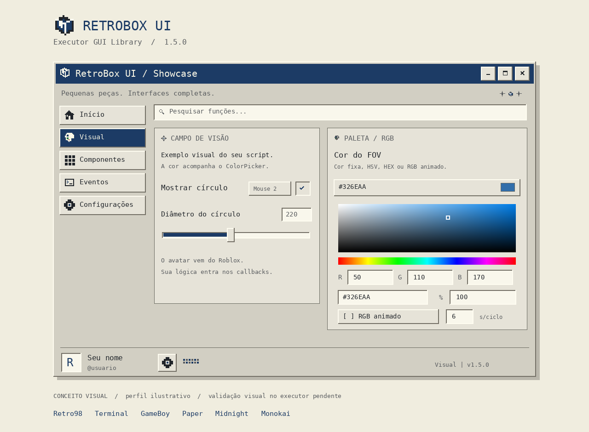
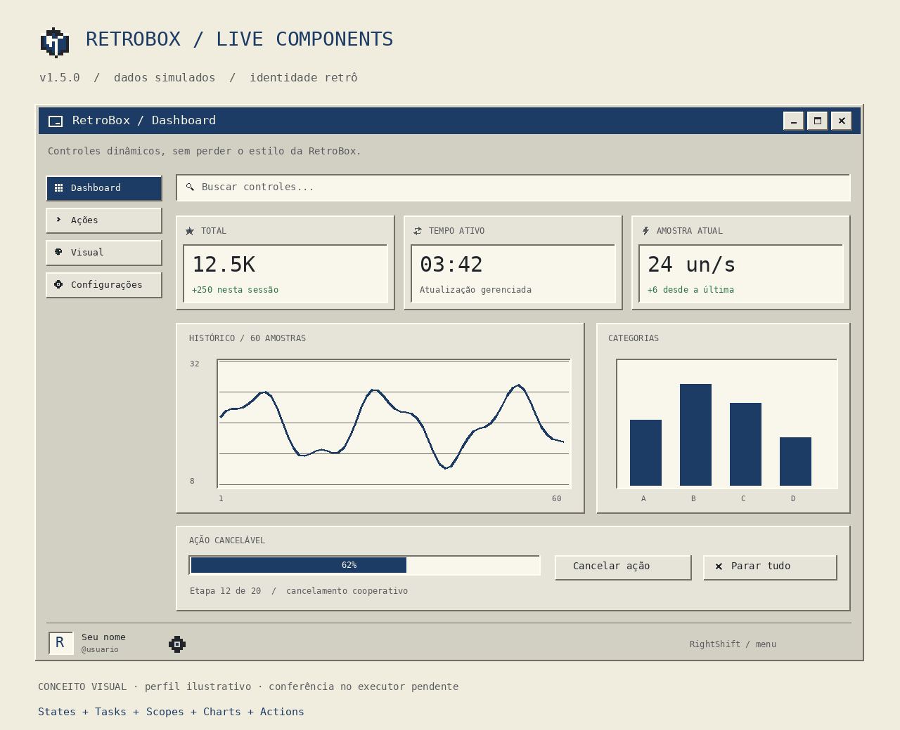
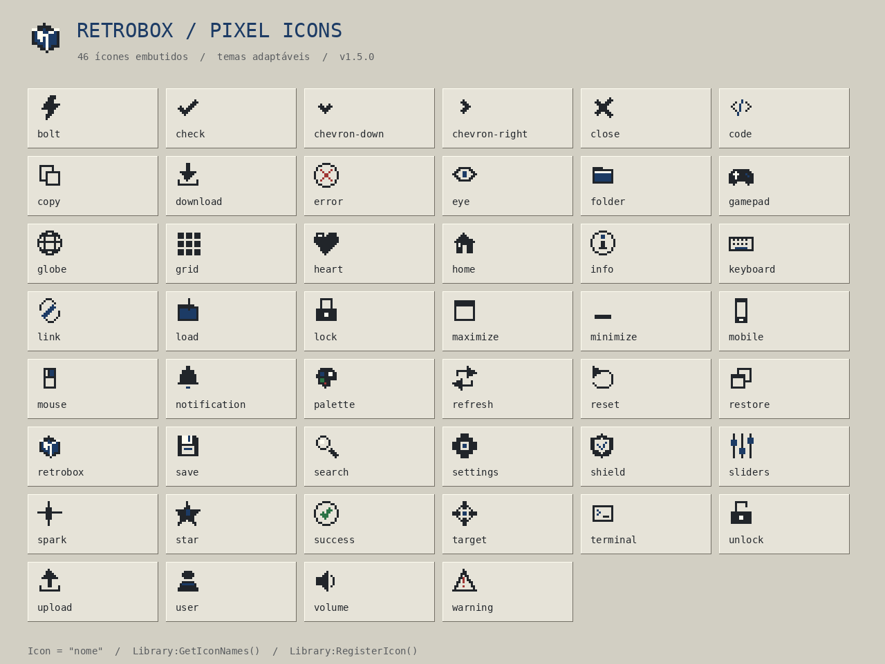

# RetroBox UI

Library de GUI em Luau para desenvolvedores de scripts executados no cliente Roblox por executores. Um arquivo independente, carregado pelo link **raw do GitHub**, com visual retrô e API para conectar componentes às funções do seu script.

[English](README.en.md) · [API completa](docs/API.md) · [Runtime 1.5](docs/RUNTIME.md) · [Publicar no GitHub](docs/GITHUB.md) · [Validação](docs/VALIDATION.md)



*A imagem é um conceito visual, com perfil ilustrativo. A GUI usa objetos nativos do Roblox; a renderização em executor ainda precisa ser conferida.*

## Carregar no executor

A fonte deste repositório fica no caminho abaixo. Se publicar em outro lugar, ajuste usuário, repositório, branch e caminho. Veja [como publicar e atualizar](docs/GITHUB.md).

```lua
local RetroBox = loadstring(game:HttpGet("https://raw.githubusercontent.com/ManoGustavo0/RetroBox/main/RetroBox-UI-v1.1.0/retrobox-ui/RetroBox.lua"))()

local window = RetroBox:CreateWindow({
    Id = "meu-script", -- estável: executar de novo substitui esta janela
    Title = "Meu script",
    Subtitle = "Feito com RetroBox UI",
    Theme = "Retro98",
    ConfigFolder = "RetroBox/MeuScript",
    ToggleKey = Enum.KeyCode.RightShift,
})

local tab = window:CreateTab({ Title = "Principal", Icon = "home" })
local category = tab:CreateSection("Controles")

category:AddToggle({
    Id = "recurso_ativo",
    Title = "Ativar recurso",
    Tooltip = "Ativa o recurso do seu script. Escreva aqui a explicação para o usuário.",
    Default = false,
    Callback = function(enabled)
        -- Conecte aqui a função do seu script.
        print("Ativo:", enabled)
    end,
})

category:AddSlider({
    Id = "intensidade",
    Title = "Intensidade",
    Min = 0, Max = 100, Default = 50,
    Callback = function(value) print("Intensidade:", value) end,
})

category:AddButton({
    Title = "Testar",
    Callback = function() window:Notify("Callback executado!") end,
})
```

O avatar, o nome de exibição e o @usuário vêm do `LocalPlayer`. A engrenagem seleciona a aba Configurações, que já vem na library. A library fornece a interface e o estado dos componentes; você escreve a lógica nos callbacks.

O executor precisa disponibilizar `loadstring` e `game:HttpGet` para esse carregamento. [Loader.lua](Loader.lua) é uma alternativa com mensagens de erro de download, compilação e inicialização. O arquivo principal não depende de outros downloads de código.

## Componentes e visual

- Janela arrastável, redimensionável, minimizável e maximizável, com título, descrição, ícone e atalho.
- Avatar e nomes no canto inferior esquerdo; engrenagem de personalização ao lado.
- Seis temas: **Retro98, Terminal, GameBoy, Paper, Midnight e Monokai**, além de temas próprios.
- Identidade em pixel art: 46 ícones embutidos, símbolo de caixa próprio, detalhes discretos e desenhos que acompanham os temas.
- Bordas em relevo, fonte monoespaçada, cores de destaque e linhas CRT opcionais.
- Abas, categorias, busca e colunas que se empilham em telas menores.
- Aba Configurações automática, com lista de saves nomeados, salvar/carregar e confirmação antes de sobrescrever.
- Pesquisa com resultados que levam à aba e ao controle escolhido, sem executar sua ação.
- Toggle, Slider, Button, Input, Dropdown simples/múltiplo, Keybind, ColorPicker, Progress, Console, Label, Separator e Image.
- Tooltip opcional em todos os controles: explicação ao passar o mouse ou segurar o título/descrição no celular.
- HSV, campos R/G/B e HEX, opacidade e RGB animado com duração de ciclo configurável.
- Notificações, callbacks protegidos, listeners e mudanças de valores por código.
- Diálogos retrô, confirmações e feedback de execução/sucesso/erro em botões.
- Captura de teclas e Mouse 1/2/3; keybind ao lado de um toggle e linhas de controles combinados.
- Atalhos flutuantes para toque, com arraste, tamanho/opacidade e posições salvas.
- JSON, perfis e salvamento automático opcional.
- Limpeza de eventos ao destruir controles ou a janela; `OnDestroy` para limpar eventos do seu próprio script.
- Cards de estatísticas ao vivo e gráficos Line/Bar/Progress/Sparkline com histórico limitado, escala automática/manual e elementos reaproveitados.
- Scopes de recursos, tarefas periódicas idempotentes, ações com progresso/cancelamento e grupos Reject/Ignore/Queue/Replace.
- Estados observáveis, bindings, dependências All/Any/Not e `SetFlags` coordenado, com callbacks após aplicar todos os valores.
- Animador central, movimento suave e preferências salvas; ReducedMotion elimina transições. Categorias podem ser recolhidas.
- Debug opcional com histórico limitado, traceback/estado e adaptador genérico de callbacks.

## Componentes dinâmicos e tarefas

```lua
local total = window:CreateState(0)
category:AddStatCard({Title="Total",Icon="star",State=total,TwoWay=false,Format="Compact"})
local history = category:AddLineChart({Title="Histórico",MaxPoints=60})
local job = window:CreateTask({Id="sample",Interval=.5,Callback=function(ctx)
    ctx:ThrowIfCancelled()
    total:Update(function(value) return value+1 end)
    history:AddPoint(total:Get())
end})
job:Start()
-- job:Stop() / window:StopAll() / window:Destroy()
```

Ocultar ou minimizar mantém as tarefas ativas por padrão. Destruir limpa os recursos gerenciados; operações longas precisam respeitar o cancelamento cooperativo. A aba Aparência controla animações e arraste. Cards, gráficos e tarefas são dados temporários; os perfis continuam salvando opções e preferências.

Veja [o guia do runtime](docs/RUNTIME.md) e [dashboard.lua](examples/dashboard.lua) para a demonstração com todas as visualizações, bindings, botões canceláveis, lote de flags, avisos e Stop All.



*Ilustração da identidade e dos novos componentes, com dados simulados; não é captura da GUI em jogo.*

## Ícones em pixel art

Use o nome do ícone em títulos, abas, categorias ou controles. O catálogo já está no arquivo Lua: os ícones padrão não precisam de imagens externas nem de novos downloads.

```lua
local window = RetroBox:CreateWindow({ Title = "Meu script", Icon = "retrobox" })
local tab = window:CreateTab({ Title = "Visual", Icon = "eye" })
local section = tab:CreateSection({ Title = "Cores", Icon = "palette" })
local control = section:AddToggle({
    Id = "visual", Title = "Mostrar recurso", Icon = "bolt",
    Callback = function(enabled) print(enabled) end,
})
control:SetIcon("target")
print(table.concat(RetroBox:GetIconNames(), ", "))
```

Há ícones padrão no título, nas abas sem ícone definido, nas categorias, na busca, na engrenagem, nas ações da janela, em dropdowns/checkboxes e em notificações/diálogos. Controles aceitam ícone opcional junto ao título. `Icon = false` remove um ícone na criação; `SetIcon(nil)` ou `SetIcon(false)` o remove depois. Emojis/textos antigos e imagens `rbxassetid://` continuam aceitos.

Em Configurações → Aparência, o jogador pode desativar os ícones padrão ou os detalhes em pixel art. Essas preferências acompanham o save; ícones explicitamente escolhidos pelo dev permanecem visíveis. Também existe `PixelIcons = false`, `PixelDecorations = false`, `window:SetPixelIcons(bool)` e `window:SetPixelDecorations(bool)`.



Veja [o guia de ícones](docs/ICONS.md), [a API](docs/API.md#ícones-em-pixel-art) e [icons.lua](examples/icons.lua), que permite navegar pelo catálogo e demonstra um desenho personalizado.

## Dicas ao passar o mouse

Cada controle aceita `Tooltip` com o texto que o desenvolvedor escrever. `Description` permanece visível abaixo do título; a dica só abre quando solicitada. Por padrão, aparece após 0.4 s com o mouse sobre o controle. No celular, segure o título ou a descrição e toque na dica ou em outro lugar para fechar.

```lua
local control = category:AddToggle({
    Title = "Mostrar círculo",
    Tooltip = {
        Title = "Como funciona",
        Text = "Mostra ou oculta o círculo criado pelo seu script.",
        Delay = 0.4,
        MaxWidth = 320,
    },
    Callback = function(enabled) print(enabled) end,
})

control:SetTooltip("Você pode mudar a explicação depois.")
-- control:ShowTooltip() / control:HideTooltip()
-- control:SetTooltip(nil) remove a dica.
```

`Tip` também é aceito como nome da opção. A dica acompanha o tema, quebra linhas e ajusta sua posição aos limites da tela. Ler uma dica não chama o callback do controle. Veja [tooltips.lua](examples/tooltips.lua) e [as opções completas](docs/API.md#tooltip).

## Toggle com tecla ao lado e atalho no celular

```lua
local feature = category:AddToggle({
    Id = "feature", Title = "Ativar recurso",
    Keybind = { Default = Enum.UserInputType.MouseButton2, Mode = "Toggle" },
    Floating = { Text = "RECURSO", Position = Vector2.new(.04,.65) },
    Callback = function(enabled)
        -- Atualize o estado do seu script aqui.
        print("Recurso:", enabled)
    end,
})
```

Clique no campo do atalho e pressione uma tecla ou botão do mouse. Escape cancela; Backspace remove. Hold ativa enquanto pressionado; Toggle alterna. `feature.Keybind` permite consultar ou mudar o binding por código. O botão flutuante aparece em dispositivos com toque quando o menu está oculto/minimizado; arraste pela barra `::` para reposicioná-lo.

O X **oculta** a janela por padrão. **Shift direito** e o botão `UI` permitem reabrir. Em Configurações, o jogador pode trocar o atalho da janela, habilitar o botão de reabrir, mudar seu texto e ajustar tamanho/opacidade dos atalhos. `DestroyOnClose = true` mantém a opção de destruir pelo X.

## Diálogos e feedback

```lua
category:AddButton({
    Title = "Executar ação", Feedback = true, BusyText = "Processando...",
    Callback = function()
        -- Sua ação pode retornar false, "motivo" para informar uma falha.
        return true
    end,
})
window:Confirm({
    Title = "Continuar?", Content = "Executar a ação escolhida?",
    OnConfirm = function() print("Ação confirmada") end,
})
```

`CreateRow()` permite colocar componentes na mesma linha, empilhando-os em telas estreitas. A pesquisa mostra os resultados com aba/categoria: clique, ou use setas e Enter, para encontrar o controle. Veja [workflows.lua](examples/workflows.lua) e [API.md](docs/API.md).

## RGB conectado ao seu script

```lua
local visual = window:CreateTab("Visual"):CreateSection("Cores")
local state = { Color = Color3.fromRGB(80, 140, 220), Opacity = 1 }

local picker = visual:AddColorPicker({
    Id = "cor_fov",
    Title = "Cor do FOV",
    Default = { Color = "#508CDC", Opacity = 1, Rainbow = false, Speed = 6 },
    Callback = function(color, opacity, value)
        state.Color = color
        state.Opacity = opacity
        -- Exemplo, quando seu script já criou um UIStroke:
        -- fovStroke.Color = color
        -- fovStroke.Transparency = 1 - opacity
    end,
})
```

`picker:GetColor()` retorna a cor atual, incluindo a animação RGB. `GetValue()` retorna a configuração da cor manual, opacidade, RGB e velocidade. `Speed` é a duração de um ciclo em segundos. O RGB usa um único evento de atualização por janela.

## Execução e configurações

Sem `Parent` explícito, a GUI tenta `gethui()`, depois `CoreGui` e depois `PlayerGui`. Cada tentativa considera a permissão para anexar a GUI. `window.ParentMode` informa o caminho usado. A seleção depende das funções disponíveis no executor.

Se houver `readfile`, `writefile` e `makefolder`, a janela usa arquivos automaticamente. `isfile` e `isfolder` são opcionais. Os arquivos ficam no workspace do executor, dentro de `ConfigFolder`. Pastas e arquivos só são criados quando uma configuração é salva. Sem essas funções, os perfis usam memória da janela.

```lua
-- Configure AutoSave = "default" em CreateWindow para salvar alterações.
-- Crie TODOS os controles antes de carregar um perfil.
local ok, err = window:LoadConfig("default")
if not ok then print("Sem perfil anterior:", err) end

local saved, result = window:SaveConfig("default")
local json = window:ExportConfig()
local imported, importError = window:ImportConfig(json)
print(window.StorageMode) -- "file", "memory" ou "custom"
```

Use `Id`, IDs de controles e `ConfigFolder` estáveis para restaurar configurações em outra execução. Com os padrões, a pasta é `RetroBox/script-<Id codificado>`. Perfis recebem nomes como `profile-default.json`; caracteres especiais são codificados para impedir colisões e separadores de caminho.

A aba Configurações permite digitar o nome do save, salvar e depois selecioná-lo na lista para carregar. Um índice mantém os nomes disponíveis em outra execução quando há armazenamento em arquivo. O save inclui valores, atribuições de teclas/mouse, cores/RGB, tema, escala e aparência/posições dos atalhos. O jogador recebe aviso de sucesso ou erro. Saves em memória duram enquanto a janela estiver aberta.

`LoadConfig` chama os callbacks por padrão. `{ Silent = true }` evita os callbacks; nesse caso, sincronize sua lógica por `GetFlag`. Valores inválidos são rejeitados antes de alterar a janela. `AutoSave` usa debounce de 0.8 s e **não carrega** o perfil automaticamente.

`FileStorage = false` seleciona memória da sessão. `Storage = { Save = ..., Load = ... }` tem prioridade sobre os arquivos e permite um backend próprio. Veja [o exemplo de configurações](examples/storage-adapter.lua).

## Exemplos incluídos

| Arquivo | Uso |
| --- | --- |
| [quickstart.lua](examples/quickstart.lua) | Carregamento raw e API mínima |
| [showcase.lua](examples/showcase.lua) | Todos os componentes e círculo de demonstração |
| [custom-theme.lua](examples/custom-theme.lua) | Paleta própria |
| [storage-adapter.lua](examples/storage-adapter.lua) | Arquivos, AutoSave e backend próprio |
| [tooltips.lua](examples/tooltips.lua) | Dicas simples, personalizadas e alteradas por código |
| [workflows.lua](examples/workflows.lua) | Saves, keybind combinado, atalhos, pesquisa, feedback e diálogos |
| [icons.lua](examples/icons.lua) | Catálogo, troca de ícones, temas e registro de pixel art própria |
| [dashboard.lua](examples/dashboard.lua) | Dados simulados, cards/gráficos, estados, tarefas, dependências e ações canceláveis |
| [executor-smoke.lua](tests/executor-smoke.lua) | Conferência na engine pelo executor |

Loader e exemplos usam o raw deste repositório. O dashboard novo requer `RetroBox.lua` 1.5.0 ou posterior nesse caminho; ícones requerem 1.4.0. Se mover a fonte, atualize as URLs conforme [GITHUB.md](docs/GITHUB.md).

## Validação e licença

120 testes locais passaram, incluindo carregamento simulado do código raw, os oito exemplos, gráficos, tarefas com yield/cancelamento, lotes, bindings, animações interrompidas, saves e limpeza de eventos. [VALIDATION.md](docs/VALIDATION.md) descreve os limites: a library ainda não foi executada em um executor real neste ambiente. Compatibilidade com um executor específico, incluindo Unbound, precisa desse teste.

MIT · Mano Gustavo · 2026
