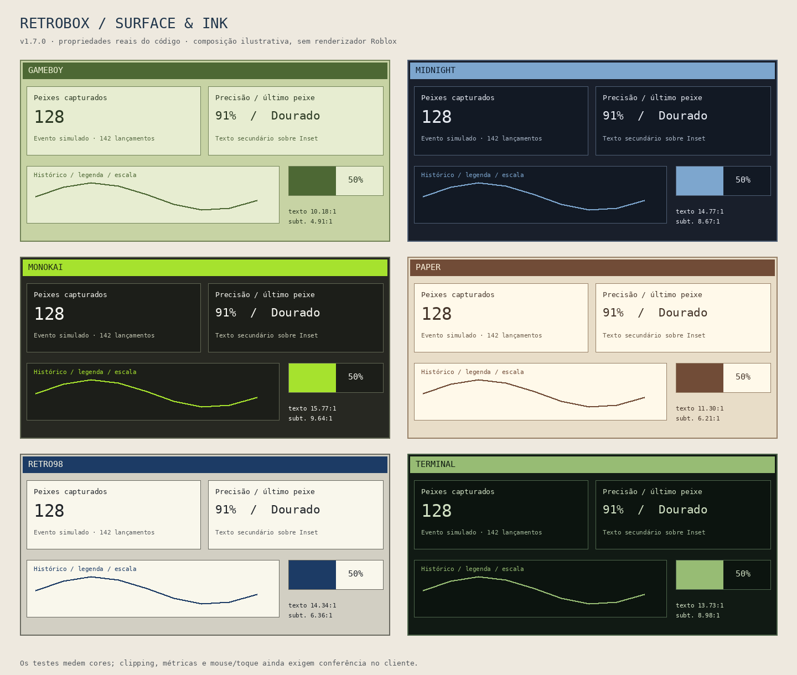

# Componentes e ferramentas · RetroBox 1.7.0

A 1.7 mantém o arquivo raw independente e a API da 1.6. Os exemplos usam dados simulados. [VALIDATION.md](VALIDATION.md) separa os testes locais da conferência pendente no executor real.

## Superfícies e contraste

O registro de estilos mantém referências fortes às Instances até o fim do componente. Referências fracas podem perder o proxy Luau enquanto o objeto permanece na interface, conforme a [documentação de metatables do Roblox](https://create.roblox.com/docs/luau/metatables). A limpeza remove estilos, fontes e destinos de foco; linhas recicladas reaproveitam suas Instances.

Bindings de estilo passam a combinar propriedades. A atualização de tema aplica primeiro fundos, depois o texto relativo à superfície encontrada na hierarquia. Isso evita deixar o card com um fundo antigo enquanto seus números recebem a paleta nova. Textos de corpos próprios, campos, consoles, escalas, legendas e tooltips recebem a mesma resolução de contraste. O percentual de progresso tem duas cópias alinhadas e recortadas: uma sobre o preenchimento e outra sobre o fundo restante.

`Library:ContrastRatio(color, background)` calcula a razão de luminância sRGB. `Library:ReadableColor(color, background, minimum=4.5)` mantém uma cor que já atende à razão; caso contrário aproxima sua luminosidade do extremo legível. Não substitui todos os textos por uma cor global. O alvo do texto normal é 4.5; séries/gráficos usam 3. Cores originais do tema permanecem disponíveis no editor e na exportação. `window:CheckThemeContrast(name?)` lista Role, Surface, Ratio, Target e Pass da paleta original; a renderização contextual pode corrigir uma combinação indicada nesse relatório.

[contrast-showcase.lua](../examples/contrast-showcase.lua) reproduz os quatro cards das capturas e acrescenta Line/Bar/Progress/Sparkline, legendas, console e campos. Alterne entre os seis temas sem recriar os componentes.

## Descrições, ajuda e acesso

`Description` continua sendo o texto curto abaixo do título. O layout mede sua largura, quebra linhas e reserva espaço apenas quando a descrição está habilitada. `Tooltip` continua sendo ajuda contextual. Ocultar descrições mantém tooltips.

| Opção / método | Contrato |
| --- | --- |
| CreateWindow `ShowDescriptions=true` | Preferência global, exposta em Configurações |
| Controle `ShowDescription=true` | false mantém só esse controle compacto |
| `control:SetDescription(text)` | Atualiza texto e layout |
| `control:SetDescriptionVisible(bool)` | Preferência do componente |
| `window:SetDescriptions(bool)` | Refluxo imediato de todos os controles |
| CreateWindow `Tooltips=true`, `TooltipDelay=.2` | Ajuda habilitada e atraso padrão em segundos |
| `window:SetTooltips({Enabled?,Delay?,MaxWidth?})` | Delay 0–3; MaxWidth 160–640 |
| CreateWindow `TextScale=1` / `SetTextScale(number)` | Escala de texto .8–1.4, separada da escala da interface |
| `window:FocusNext(reverse?)` | Percorre destinos visíveis; Enter/Espaço ativam o foco |

Título, descrição e área informativa compartilham a espera da dica: passar entre regiões não reinicia o timer. O botão de informação abre a ajuda por clique/toque. Toque longo continua disponível. Arraste, digitação, modais, troca de contexto e ocultação encerram a dica. A borda de foco indica a navegação por Tab/Shift+Tab. Campos com foco preservam sua digitação; listas/árvores possuem teclas próprias depois de selecionar uma linha.

Veja [help-accessibility.lua](../examples/help-accessibility.lua).

## Listas virtuais

```lua
local list=section:AddVirtualList({
    Id="items",Title="Itens",Height=260,RowHeight=32,
    Items={{Id="a",Text="Alpha"},{Id="b",Text="Beta"}},
    OnSelect=function(item,key,index) print(key,item.Text) end,
})
list:ScrollToKey("b")
```

Items é um array denso, limitado a 20.000 entradas e ao orçamento de cópia de dados de 32.768 chaves/16 níveis. Records precisam de IDs únicos ou GetKey(item,index); sem Id/Key/GetKey, o índice vira a chave. Chaves são convertidas em texto, de 1–128 bytes. Os dados são copiados; funções/Instances e ciclos são rejeitados. Use IDs estáveis para preservar seleção e âncora de rolagem ao substituir dados.

A viewport tem altura de linha fixa (28–80 px, padrão 32), overscan de duas linhas e pool limitado a 64 linhas. Height aceita 120–900. Searchable=false remove a pesquisa. Format(value,item,index) pode formatar o texto; deve ser uma função pura. Dados não são flags: o valor do controle é a chave selecionada ou nil. Persist=false é padrão; Persist=true salva só essa chave, exigindo dados compatíveis antes do load.

| Método / opção | Uso |
| --- | --- |
| `SetItems(array)` / `GetItems()` | Substituição validada / cópia dos dados |
| `GetSelected()` | Item copiado e chave; nil quando não selecionado |
| `SetQuery(text)` | Pesquisa literal de até 256 bytes |
| `SetFilter(predicate?)` | Predicate(item,key) retorna true para incluir; nil remove |
| `SetLoading(bool)` | Estado de carregamento sem permitir seleção |
| `ScrollToKey(key)` | Retorna false se não houver resultado visível |
| `GetViewStats()` | Items, Filtered, AllocatedRows, RowHeight |
| `DataState=state` | Observa um State de dados; limpa listener no Destroy |
| `State=state` | Binding da seleção, conforme BindState tradicional |
| `Callback(key,control)` | Mudança do valor; OnSelect oferece item/chave/índice |
| `SetContextMenu(itemsOrProvider)` | Provider(item,key,control) constrói ações da linha |

Depois de clicar em uma linha: Up/Down, Home/End, PageUp/PageDown e Enter. Linha reciclada lê o item atual, sem reter callbacks da posição anterior.

## Tabelas

```lua
local tableView=section:AddDataTable({
    Id="records",Title="Registros",
    Columns={{Key="Name",Title="Nome",Width=180},{Key="Value",Title="Valor",MinWidth=100}},
    Rows={{Id="a",Name="Alpha",Value=12},{Id="b",Name="Beta",Value=3}},
})
tableView:Sort("Value",true)
```

A tabela usa a mesma viewport virtualizada. Aceita 1–16 colunas: Key único, Title, Width opcional em pixels (48–1200), Weight (padrão 1, até 100), MinWidth (48–600, padrão 88), Sortable=true e Format(value,row,index). Colunas flexíveis distribuem o espaço restante; a rolagem horizontal mantém colunas legíveis quando não cabem. Cabeçalhos acompanham essa rolagem. Valores ausentes mostram um travessão.

`SetRows` é alias de SetItems. `Sort(key,descending=false)` ordena números numericamente e outros valores como texto; empates preservam a ordem dos dados. Cabeçalhos alternam crescente/decrescente. Pesquisa, filtros, seleção, loading, bindings e menu de linha seguem a lista. Atualizar valores não recria as linhas. Veja [advanced-components.lua](../examples/advanced-components.lua).

## Árvore

`section:AddTreeView({Id,Title,Nodes,Height?,Default?,NodesState?})` recebe nós `{Id,Text?,Title?,Icon?,Children?}`. IDs únicos, até 5.000 nós e profundidade 16, também sujeitos ao orçamento de cópia. Ícones usam o catálogo/asset da library. A lista achatada dos nós visíveis usa o mesmo pool.

Métodos: `SetNodes(array)`, `SetExpanded(id,bool)`, `IsExpanded(id)`, `ExpandAll(bool=true)` e `SetQuery(text)`. A busca mantém ancestrais dos resultados. Clique/Enter alterna um nó com filhos; Right expande; Left recolhe ou seleciona o pai. Mudanças de dados invalidam seleções que saem da vista. NodesState observa dados; State pode observar/vincular a seleção. Destruir limpa o pool e listeners.

## Menus contextuais

```lua
window:ContextMenu({Items={
    {Text="Detalhes",Icon="info",Callback=function() print("Selecionado") end},
    {Separator=true},
    {Text="Excluir",Confirm="Confirmar exclusão?",Callback=function() print("Confirmado") end},
}},Vector2.new(400,300))
```

Anchor pode ser um ponto de tela, GuiObject ou omitido para usar o mouse. Width é 80–420, ajustado à viewport. Cada item aceita Text, Icon, Disabled, Callback, Confirm (texto) ou Items (submenu). Limites: 64 itens por nível, quatro níveis, 256 entradas totais; ciclos são rejeitados antes da criação.

Clique fora/Escape fecha. Up/Down seleciona; Enter/Right abre/executa; Left volta do submenu. Submenus ajustam o lado conforme o espaço. `menu:Select(index)` seleciona explicitamente no painel atual; `Close(reason?)` libera tudo. Controles aceitam `SetContextMenu(itemsOrProvider)` por botão direito/toque longo. Menus, palette e modais compartilham exclusão de overlays; ocultar, trocar aba, mudar layout ou destruir encerra o overlay.

## Dashboard Builder

```lua
local dashboard=section:CreateDashboard({Id="layout",Title="Métricas",Columns=2,Editable=true})
dashboard:AddStatCard({Id="total",Title="Total",Value=120})
dashboard:AddLineChart({Id="history",Title="Histórico",Data={1,3,2},Span=2,Height=220})
```

É um container dos componentes existentes. Columns 1–4, Gap 0–32 (padrão 12), StackAt 200–1200 (padrão 480). Reaproveita AddStatCard, AddChart e aliases, AddProgress e AddLabel. Cada widget tem Id único, Span e altura; até 256 widgets.

`GetLayout()` retorna `{Order={ids},Widgets={[id]={Span,Height}}}`. `ValidateLayout(data)` prepara uma cópia; `SetLayout(data)`, `SetOrder(ids)`, `SetWidgetLayout(id,{Span?,Height?})` e `ResetLayout()` movem/redimensionam sem reconstruir controles ou bindings. Ao restaurar layouts antigos, widgets desconhecidos são ignorados e widgets novos mantêm padrões. SetOrder exige todos os IDs atuais.

Editable=true oferece um botão/menu de layout em cada widget: mover antes/depois, span, alturas predefinidas e restaurar. Em viewport estreita, a grid empilha. Apenas layout acompanha o perfil; dados/históricos continuam transitórios. Veja [dashboard-builder.lua](../examples/dashboard-builder.lua).

## Theme Studio

`window:OpenThemeStudio()` abre/reutiliza um editor com componentes reais. CreateWindow `ThemeStudio=true` opta por abrir na criação. Configurações também tem um botão de acesso. Temas oficiais são protegidos no editor; crie uma variação antes de editar.

| Método | Contrato |
| --- | --- |
| `GetThemeRoles()` / `GetThemeColors(name)` | Cópias dos tokens e das cores |
| `CreateTheme(name,baseName?)` | Variação local; nome 1–48 bytes; até 32 temas |
| `DuplicateTheme(source,name)` | Copia uma paleta sem modificar o original |
| `SetThemeColor(name,role,color)` | Edita só catálogo local; preview imediato |
| `RestoreTheme(name)` | Cores capturadas na criação/importação |
| `DeleteTheme(name)` | Protege oficiais; muda para a base se excluir o ativo |
| `ExportTheme(name?)` | JSON de paleta, sem código |
| `ImportTheme(source,{Name?,Replace=false}?)` | Retorna ok/nome ou false/erro; até 16 KiB |
| `CheckThemeContrast(name?)` | Relatório das combinações originais |
| `LoadThemeCatalog(profileName)` | Lê catálogo do perfil sem aplicar flags do script |

O editor usa os tokens reais: Background, Surface, Inset, Text, Muted, Border, Highlight, Shadow, Accent, AccentText, Success e Danger. Hover usa Highlight; seleção usa Accent/AccentText; gráficos usam Inset/Accent. A resolução contextual cuida do texto sobre cada superfície. Não há um segundo sistema de temas.

CustomThemes ficam em Appearance.Advanced do perfil normal. Salvar pelo editor usa SaveConfig; carregar catálogo usa LoadThemeCatalog. O catálogo não guarda funções, Instances nem execução. JSON não passa por loadstring. Importação protege nomes oficiais/registrados e valida todos os tokens antes de alterar a janela. O RegisterTheme tradicional continua disponível para temas definidos pelo desenvolvedor. Veja [theme-studio.lua](../examples/theme-studio.lua).

## Runtime Inspector

`window:OpenRuntimeInspector({AllowCancel=false,Interval=1}?)` abre/reutiliza o painel. CreateWindow `RuntimeInspector=true` ou uma tabela opta por abrir; Debug mostra um botão, sem abrir automaticamente. Por padrão ele não aparece para todos os usuários.

Overview, Tasks, Actions/Groups, Resources e Diagnostics usam estatísticas e estados existentes. Task/Action Subscribe atualizam fases; uma tarefa em intervalo .25–10 s atualiza prazos e recursos quando o painel está visível. Não há redraw/polling por frame. Ações terminais seguem o histórico de 32; diagnósticos seguem o limite de 64; detalhes de recursos mostram até 256 registros da raiz.

`GetRuntimeSnapshot()` retorna cópias serializáveis/resumos de Stats, Tasks, Actions, Groups, Resources e Diagnostics, sem expor Instances dos recursos. A ferramenta oferece filtros, detalhes/JSON, localização de componentes e cópia por setclipboard quando disponível; sem ela, o campo de texto permite copiar manualmente.

AllowCancel=true habilita botões de parada/cancelamento, ainda com confirmação. Sem essa opção o painel é de leitura. `inspector:Refresh()` atualiza explicitamente; `Destroy()` remove o painel, listeners e sua tarefa de relógio. Veja [runtime-inspector.lua](../examples/runtime-inspector.lua).

## Command Palette

F4 é o atalho padrão; `CommandKey` em CreateWindow e `SetCommandKey(Enum.KeyCode)` configuram. Unknown desativa; Configurações captura outra tecla. `OpenCommandPalette()` abre um overlay de busca com controles existentes, abas e comandos registrados.

```lua
local registration=window:RegisterCommand({
    Id="example",Title="Mostrar mensagem",Icon="notification",
    Callback=function(ctx) ctx:ThrowIfCancelled(); window:Notify({Content="Executado"}); return true end,
})
```

RegisterCommand exige Id (1–128), Title (1–256) e Callback(ctx,window,command). Aceita Description, Icon, Enabled (bool/predicate), Confirm (texto), Group e Policy. Até 128 comandos; registration:Destroy remove. `ExecuteCommand(id)` usa RunAction e retorna handle/erro; Confirm solicita confirmação e retorna nil, "confirmation pending". O grupo padrão é o Id do comando, Policy padrão Reject.

`GetCommandResults(query)` retorna até 100 resultados com Kind, TargetId, Title, Description, Id e Text. A busca de controles reutiliza SearchControls/FocusControl. Digitar ou destacar resultados não executa nada. Escolher uma função navega; escolher um comando executa explicitamente. Up/Down/Enter/Escape e clique funcionam; fechamentos liberam fontes, foco e linhas. Veja [command-palette.lua](../examples/command-palette.lua).

## Perfis e compatibilidade

SaveConfig/LoadConfig/ExportConfig/ImportConfig, ConfigVersion e migrações continuam disponíveis. Appearance.Advanced acrescenta descrições, texto, dicas, CommandKey, catálogo e layouts. Dados são validados antes de aplicar flags/aparência; perfis antigos sem Advanced continuam aceitos. Registre componentes/dashboards e migrações antes de carregar.

`DeleteConfig(name)` retorna ok/erro, remove o backend/cópia da sessão e atualiza a lista. Configurações confirma o nome antes de excluir. Carregar/excluir o perfil ativo não reseta automaticamente os controles. Excluir um perfil com AutoSave interrompe esse AutoSave e seu debounce, evitando recriá-lo logo depois.

A API de armazenamento acrescenta `Delete(name) -> true | false,reason`. Sem Delete, a library informa indisponibilidade e mantém os dados. O adaptador de arquivos usa delfile quando disponível; atualiza o índice e tenta restaurá-lo se a remoção falhar. Falha de restauração é reportada explicitamente. Os demais perfis não são removidos.



Composição ilustrativa das propriedades reais exportadas pelo código, não uma captura de jogo. Para reconstruí-la: `python3 tests/run_headless.py tools/export_contrast.lua`, depois `python3 tools/build_contrast_preview.py`. O fixture tests/fixtures/contrast-regression.json descreve a combinação ruim das capturas e é exercitado pela suíte.
