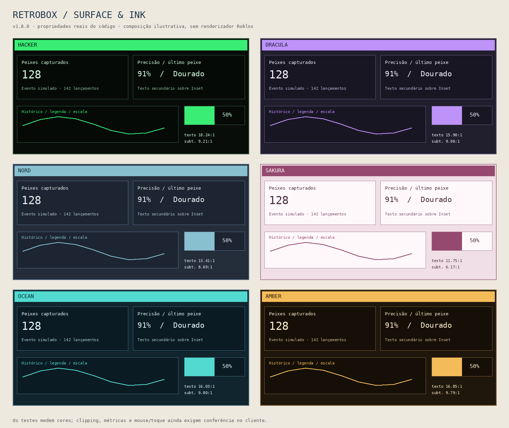

# Temas · RetroBox 1.8.0

A 1.8 acrescenta seis paletas oficiais. Os doze temas aparecem em Configurações e podem ser selecionados por código, salvos em perfis ou duplicados no Theme Studio.

| Tema novo | Identidade |
| --- | --- |
| `Hacker` | Superfícies quase pretas, verde vivo nos destaques, texto verde suave e alertas em coral. |
| `Dracula` | Fundos roxos escuros, destaque lilás e texto claro. |
| `Nord` | Azul acinzentado, destaque azul gelo e texto frio. |
| `Sakura` | Superfícies claras rosadas, texto ameixa e destaque rosa fechado. |
| `Ocean` | Azul profundo, turquesa e texto claro. |
| `Amber` | Fundos quentes escuros e âmbar inspirado em monitores antigos. |

Os temas anteriores continuam disponíveis: `Retro98`, `Terminal`, `GameBoy`, `Paper`, `Midnight` e `Monokai`. O padrão permanece `Retro98`; o nome `Hacker` descreve apenas a aparência da paleta.

```lua
local window = RetroBox:CreateWindow({Id = "meu-script", Theme = "Hacker"})
window:SetTheme("Ocean")
local names = RetroBox:GetThemeNames()

-- A paleta oficial é preservada. Edite uma cópia no Theme Studio.
window:DuplicateTheme("Hacker", "Meu Hacker")
window:SetThemeColor("Meu Hacker", "Accent", "#68F0A2")
window:SetTheme("Meu Hacker")
```

`SaveConfig`/`LoadConfig` preservam o tema escolhido e o catálogo de variações. Os nomes são estáveis; esta atualização não altera `Schema` ou `ConfigVersion`, nem exige migrações dos perfis existentes. Perfis de uma versão antiga continuam carregando na 1.8. Uma versão antiga não reconhece os novos nomes de tema.

Cada paleta define os doze tokens existentes: `Background`, `Surface`, `Inset`, `Text`, `Muted`, `Border`, `Highlight`, `Shadow`, `Accent`, `AccentText`, `Success` e `Danger`. A troca repinta os mesmos widgets, e a resolução contextual de contraste da 1.7 continua protegendo a tinta sobre cada superfície, inclusive hover, seleção e preenchimento.

Execute [themes-gallery.lua](../examples/themes-gallery.lua) para comparar as seis novidades em cards, Line/Bar/Progress/Sparkline, console e tabela. O slider testa percentuais de 0 a 100. [contrast-showcase.lua](../examples/contrast-showcase.lua) oferece os doze temas nos casos das capturas anteriores. Os exemplos usam dados simulados; antes do merge, substitua `main` pelo commit da PR no loader.



A imagem é uma composição ilustrativa das propriedades de cor obtidas dos widgets em testes, sem renderizador Roblox. Não representa uma captura de jogo. A inspeção nativa de fonte, recortes, rolagem e entrada segue pendente, conforme [VALIDATION.md](VALIDATION.md).
